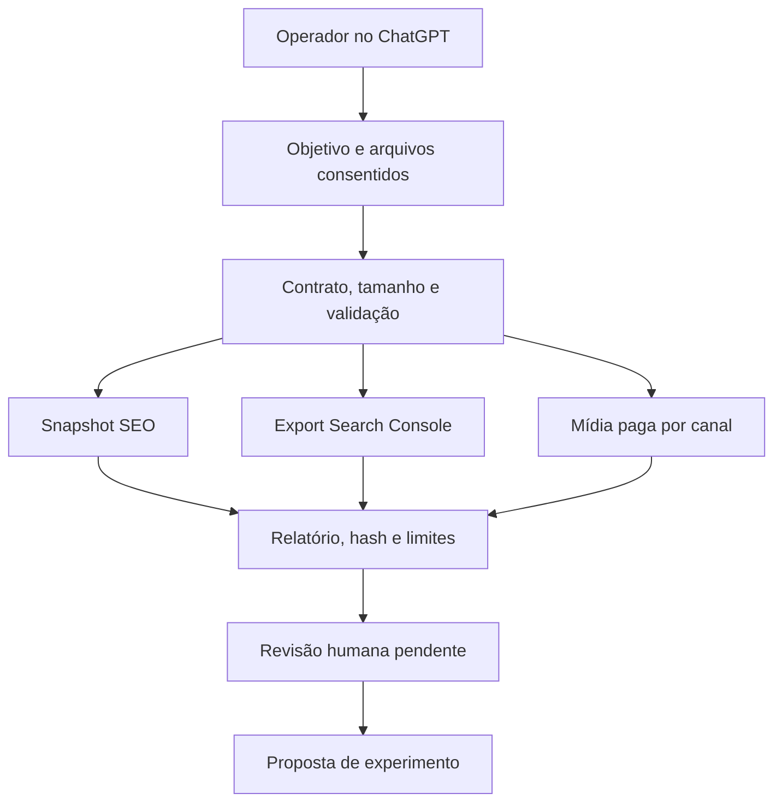

# NotFair → Camaleão Marketing Copilot

Auditoria e adaptação em 17/10/2026. Fonte pública: [nowork-studio/notfair-plugin](https://github.com/nowork-studio/notfair-plugin/tree/c839f30bfea788b822d1ab1b6f1a8cc4c0d3020d), commit `c839f30bfea788b822d1ab1b6f1a8cc4c0d3020d`. Decisão principal: **C — EXTRACT**. Novo repositório solicitado: `ofelipepeixoto/camaleao-marketing-copilot`, experimento com implementação original MIT e referências upstream atribuídas.

## 1. Executive Summary

O componente valioso é o conhecimento operacional organizado por tarefa, com métricas e propostas revisáveis. O projeto público não contém seu MCP hospedado: copiar skills não reproduz o SaaS nem conecta contas. O ecossistema já possui SEO, conteúdo, portal, evidências e autorização; copiar a suíte inteira ampliaria sobreposição.

Foi preparado um recorte funcional para ChatGPT: instruções PT-BR e motor local para snapshots HTML, export Search Console normalizado e mídia paga normalizada. Nenhuma conta, CMS, orçamento ou produção foi alterada. A versão é experimental e aguarda revisão humana antes do merge e homologação na conta ChatGPT.

## 2. GitHub Ecosystem Context

Inventário anterior à criação: **40 repositórios públicos** com metadados atuais; oito relacionados receberam leitura de README e árvore em commits fixados. O acesso à conta inclui outros projetos, mas nomes/conteúdo privados não foram incorporados à entrega pública. Metadados não comprovam funcionamento, adoção ou produção.

O mapa completo público está em [public-ecosystem.json](public-ecosystem.json). Python aparece em documental, avaliação, revisão de fontes, evidências, roteamento e produtos; TypeScript em portais/OaaS/Hermes; JavaScript no Hub e Security Workbench. Alguns forks têm linguagem nula no GitHub: isso é ausência de metadado, não ausência de código. Descrições de terceiros continuam alegações dos autores.

Mapa funcional: documental/RAG e jurídico; governança/evidências/roteamento; produtos e portais; criação audiovisual; referências de SEO/estilo; segurança; memória/agentes; laboratório Colab. Atividade por pushed_at não diferencia experimento de produção ou garante manutenção.

## 3. Repository Overview

[CODE VERIFIED] Versão0.27.17, **289 arquivos rastreados**, 48 wrappers SKILL.md e 48 workflows canônicos. Categorias: SEO20, paid-ads14, Google Ads5, Meta Ads3, analytics2, WordPress1, CRM1, Gemini1 e atualização1. Há46 Python (22produção),5Bash e26 arquivos de eval com68 casos declarados, não executados.

Não há aplicação web/backend próprio embarcado, pyproject ou package.json. Scripts locais fazem SEO/GSC/PageSpeed/CMS/calendário; manifestos integram diferentes hosts. Entrypoint conceitual: AGENTS → wrapper → WORKFLOW → referência/script ou MCP remoto.

## 4. Evidence Level

| Nível | Evidência nesta entrega |
| --- | --- |
| CODE VERIFIED | Licença, manifests, scripts, fronteiras de transporte, contratos e workflows lidos |
| TEST VERIFIED | 334 checks estruturais; contratos estáticos MCP:3 aprovados/1falha/2ignorados;5 observações de segurança reproduzidas |
| DOC CLAIM | Suporte comercial a plataformas, ganhos GEO e capacidades do servidor hospedado |
| INFERENCE | Adequação dos padrões ao ecossistema, potencial de produto, riscos condicionados ao deployment |
| NOT VERIFIED | Suíte unit completa, E2E/LLM juiz, OAuth real, servidor MCP, corpus de marketing real, desempenho comercial e produção |

Sintaxe dos46Python e5Bash passou em verificação estática. Checks de estrutura/sintaxe não são testes de comportamento. A suíte unitária original foi interrompida por revisão automática e não recebeu resultado final; não contar pontos parciais do log como aprovados.

Motor novo: 38 testes próprios e oito testes independentes aprovados, três exemplos CLI executados. Um ensaio de agente em contexto novo respeitou os limites declarados (ver chatgpt-rehearsal.md). CI remota é registrada na PR da entrega, com distinção de cenário sintético. Hash de export comprova vínculo aos bytes recebidos, não autenticidade, completude ou verdade.

## 5. License & IP

[CODE VERIFIED] MIT no upstream: Copyright(c)2026 Toprank Contributors. Permite reutilização/modificação/redistribuição sob preservação do aviso. A licença original foi mantida em third_party/notfair/LICENSE. Código Python e instruções novas têm MIT de Carlos Felipe, sem reatribuir autoria do upstream.

Nenhum crawler, instalador, script CMS, logo, asset ou servidor NotFair foi copiado para o runtime. O catálogo gerado contém nomes, hashes e links dos48wrappers. Ele é referência, não instalação. MIT do código público não concede serviço hospedado, marca, credenciais, dados ou contratos de plataformas. Não há pesos de modelos distribuídos no escopo.

## 6. Architecture Review

O upstream separa instrução de host e workflow canônico, o que reduz duplicação conceitual. Porém48entradas, múltiplos manifests, scripts legados e servidor privado exigem sincronização e verificação de capacidades por sessão. Deriva de versão foi comprovada em server.json.

O novo projeto separa instruções de conversa de análise determinística. Não se pressupõe que um prompt contenha ferramentas externas. O motor não chama LLM, rede ou mutações; estado de revisão é sempre pending. O uso real dentro do ChatGPT ainda precisa de operador e arquivos acessíveis.

## 7. Code Quality

Pontos positivos: documentação legível, wrappers pequenos, contratos de segurança explícitos, testes de transporte e escrita atômica em helper local. Pontos de atenção: repetição de seleção de .env entre CMSs, sem lock de dependências, testes que reproduzem expressão em vez de fluxo e um teste de robots cujo corpo é pass.

A fronteira de transporte deve ser injetável e testada sem credenciais/ADC. Manifests devem derivar da mesma versão. Evitar refatoração geral: estes são pontos de falha específicos, não razão para migrar todo Python/Bash.

## 8. Security Audit

Cinco observações sintéticas confirmadas, severidade **média condicionada ao uso**; nenhuma exploração de serviço real ou vazamento de segredo comprovado:

| ID | Componente/evidência | Impacto condicionado | Correção proposta |
| --- | --- | --- | --- |
| NF-SEC-01 | push_strapi_seo.py:122–134 e padrão em outros CMSs | .env ancestral sobrescreve .env.local do cliente atual; alvo/credencial pode mudar | Raiz explícita; precedência projeto sobre ancestral; exibir alvo antes de escrita |
| NF-SEC-02 | push_strapi_seo.py:220–228,356–359,398–399 | GET atual falha, mas PUT pode continuar com guarda de versão descartada | Falhar fechado e usar precondição atômica se suportada |
| NF-SEC-03 | fetch_ghost_content.py:102–139,177 | Preflight DNS não restringe redirects/conexão; GET pode alcançar rede privada | Revalidar/pinar DNS em cada conexão e limitar redirects à origem |
| NF-SEC-04 | checker.py:157,199,203–205 | max_pages não limita corpo, fila ou total de checagens de links | Quotas de bytes/URLs/requisições, fila limitada e deadline global |
| NF-SEC-05 | push_strapi_seo.py:343,391–396,443–449 | ID do lote altera path/query de chamada privilegiada | Schema e segmentos por versão, validação de lote antes de operar |

Cinco observações passaram porque reproduziram as falhas; não significam correção. Detalhes, condições, controles positivos e casos de aceitação em [security-notes.md](audit/security-notes.md). Nenhum patch foi aplicado ao upstream. Na adaptação os componentes de rede/escrita foram omitidos; isso reduz exposição do recorte, não corrige o projeto original.

Outros limites: calendário padrão loopback pode ser exposto com --host; CMS permite HTTP configurado pelo operador; MCP privado impede auditar RBAC, tenants, tokens e gastos. Busca limitada de padrões de segredos não encontrou correspondências no checkout inspecionado; histórico e todos os formatos não foram varridos. Advisories de dependências não foram consultados para um ambiente runtime completo: nenhuma CVE nem ausência de CVE é afirmada.

## 9. Performance

[TEST VERIFIED] Uma página sintética com120links e max_pages=1 agenda120checagens; read(-1) não limita bytes. É reprodução de comportamento, não benchmark de carga. O motor novo limita entrada a1MiB, HTML256KiB,5.000linhas e100findings. Decimal preserva cálculo financeiro sem float binário.

Não há medição de latência p95, throughput ou memória máxima sob concorrência. Evitar qualquer SLA. O recorte local dispensa cache/filas nesta etapa; dados volumosos exigem novo ensaio e paginação projetada, não aumento silencioso dos tetos.

## 10. Scalability

| Cenário | Conclusão |
| --- | --- |
| Local/um operador | Recorte adequado para validar arquivos pequenos em diretório confiável |
| 10operadores | Processos isolados e arquivos por trabalho; colaboração/retencão externas, sem prova de carga |
| 100–1.000usuários | Exige serviço autenticado, quotas globais, fila, retenção, isolamento e benchmark |
| 10.000/multitenant | Não projetado ou validado; não inferir escala a partir de funções sem estado |

Não há banco, RLS, tenant autenticado, cache ou fila no adaptador. Isso limita a implantação; não é defeito para um CLI local. Não reaproveitar project_id como autorização.

## 11. AI Engineering

O upstream é um pacote de procedimentos para agentes existentes, não um modelo próprio. Há evals declarados, mas juízes LLM e E2Es não executados. Afirmações quantitativas de ganhos GEO presentes nas instruções não foram revalidadas; não foram transportadas para o produto Camaleão.

Na adaptação, cálculos e limites ficam em código; ChatGPT interpreta relatório e propõe próximos experimentos. Não há chamada de API paga, modelo fixo, embedding ou roteamento. Custo de API adicional pelo núcleo: nenhuma chamada; custo da assinatura/ambiente do operador é separado. Sem avaliação de qualidade gerativa, CTR lift, CAC ou ROI real.

## 12. Agentic AI

Roteamento por intenção e procedimentos especializados são úteis. Não há motivo para introduzir planner/multiagente autônomo na aplicação: o fluxo é determinístico, com interpretação conversacional opcional.

Foram usadas revisões de engenharia paralelas nesta auditoria; isso não instala múltiplos agentes no produto. O usuário escolhe objetivo, fornece dados, recebe observações/propostas e revisa. Retries de ações externas não existem porque ações externas não existem no núcleo.

## 13. RAG

Não há RAG completo no upstream público ou no recorte implementado. Documentação de skills e fontes consultadas não equivalem a índice vetorial, recuperação autorizada ou avaliação de groundedness.

Não adicionar pgvector/embedding. Para validar citações de conteúdo, aproveitar revisão de fontes existente após uma integração própria; hoje o parser mede campos de snapshot e não confirma suas alegações. Encontrar title ou JSON-LD não prova veracidade.

## 14. MCP Opportunities

O MCP NotFair é dependência externa OAuth; implementação privada não auditada. Não foi instalado nem conectado. Catálogo de ferramentas em docs não comprova disponibilidade de todas as contas/plataformas.

Futuro adaptador read-only no Hub pode expor análise de arquivo como ferramenta se houver vários consumidores comprovados. Exigir conta/escopo, schema, limites, isolamento e testes de revogação; não abrir servidor para uma função interna trivial. Escrita em campanhas/CMS é fase separada.

## 15. n8n Opportunities

n8n pode futuramente orquestrar recebimento de export consentido → análise → fila de revisão → entrega aprovada. Cálculos, limites e validação permanecem em código. Não são necessários workflow gigante, community node ou credenciais nesta entrega.

Nenhum workflow foi importado, ativado ou homologado na VPS. Para backend comercial/white-label, revisar edição/versão/termos atuais no uso concreto antes de dar acesso a clientes; não declarar liberação de licença por ocultar editor.

## 16. Infrastructure

Linux/Python3.11+ e filesystem confiável bastam para o laboratório. CLI IO usa controles POSIX; Windows não foi homologado. A análise em memória usa stdlib; não há servidor, dependência runtime de terceiros ou necessidade atual de VPS, GPU, Redis, Docker, Kubernetes ou banco adicional.

A interface é o ChatGPT com arquivos/instruções e, quando disponível, ambiente de código. Não houve instalação automática na conta. A [documentação oficial de projetos](https://learn.chatgpt.com/docs/projects), consultada em17/10/2026, confirma uso compartilhado de fontes/instruções; acesso a pastas e ferramentas não é presumido.

## 17. Observability

Hash de entrada, versão de schema, findings por JSON pointer, metadados de período/medição e testes fornecem investigação reproduzível local. O relatório evita eco de HTML/query/campanha/IDs, mas métricas ainda podem ser sensíveis; hash não é anonimização universal.

Não há telemetria, export de logs, retenção automática, alertas ou tracing live. Se surgir serviço, medir erro por modo, rejeição por limite e duração com dados redigidos antes de introduzir stack de observabilidade. Não instalar Langfuse/Grafana por disponibilidade.

## 18. Stack Decision Matrix

| Tecnologia | Decisão | Motivo e consequência |
| --- | --- | --- |
| Python/stdlib | ADOPT | Parser/cálculos/contrato simples, sem supply chain runtime extra |
| Markdown/JSON | ADOPT | Instruções transportáveis e entrada/saída reproduzível |
| ChatGPT | EXPERIMENT | Conversa guiada, homologação humana ainda pendente |
| NotFair48skills | WATCH/reference | Sobreposição; catálogo fixado, sem instalação |
| MCP hospedado | Não adotar nesta entrega | Código privado, conta/termos/escopo não homologados |
| Supabase/pgvector | Não adicionar | Nenhuma persistência ou busca vetorial necessária |
| n8n/Hub/EvidenceKit | WATCH integração futura | Reusar autorização/evidência existentes depois de contrato real |
| Next/React/servidor/GPU | Não adicionar | Não resolve requisito desta fatia |

Cada tecnologia nova deve provar benefício e custo; não houve compra/contratação. Sair da solução significa exportar JSON/Markdown, sem migração de banco.

## 19. GitHub Integration Map

| Destino existente | Papel futuro | Limite atual |
| --- | --- | --- |
| open-seo | Especialista SEO/GEO/keyword | Não duplicar rastreador/plugin/MCP |
| no-ai-slop | Revisão de voz/estilo | Não confundir estilo com verdade |
| creator-lab | Evidência criativa autorizada | Sem scraping/API paga aqui |
| camaleao-portal | Pedidos/revisões/versões | Não criar segunda UI/fila/editorial |
| radar-oaas | Prontidão e experimento de negócio | Sem novo score de certificação |
| radar-integration-hub | Autoridade, orçamento e conectores | Não integrado/homologado nesta entrega |
| radar-evidence-kit | Contrato e recibo real | JSON do Copilot não se declara recibo compatível |
| skill-revisao-de-fontes | Verificação factual | Arquivo fornecido não equivale a fonte autenticada |

Commits/links e fundamentos completos em [ecosystem-notes.md](audit/ecosystem-notes.md). Nenhum desses repositórios foi alterado.

## 20. Product Opportunities

Hipótese principal: ferramenta interna assistida para agência/consultor revisar exports e apresentar propostas com fórmulas e lacunas explícitas. ICP: equipe que já coleta dados e perde tempo normalizando relatórios; não um comprador de marketing autônomo. Diferenciação ainda a medir: tempo até proposta revisada e redução de erro grave.

MVP implementado: três análises offline, instruções PT-BR, fontes/limites e testes. Moat não demonstrado; código/parser não criam barreira competitiva. Cobrança possível somente após validar serviço de revisão e valor; preço/receita/margem não medidos. Não lançar outro SaaS antes da avaliação humana. Custos operacionais da ferramenta local são processo/armazenamento; assinaturas e trabalho de revisão continuam custos separados.

## 21. Architecture 2.0

Não há aresta de execução/publicação. Anexar um arquivo não concede autoridade; uma ponte futura precisa de aprovação ligada à ação aplicada no servidor e verificação de resultado. Decisão detalhada em ADR0001.

## 22. Code Improvements

No upstream, os cinco patches de desenho propostos são precedência explícita, fail-closed de escrita, transporte com fronteira de rede, quotas totais e IDs estritos. Não foram aplicados nem publicados ao projeto de terceiros. A falha de versão e o mock de rede também precisam de correção antes de release upstream.

Na adaptação, implementação original aplica contratos estritos, Decimal, limites de bytes/linhas/findings, saída exclusiva, recusa symlinks e ausência de rede/escrita em contas. Strings externas não são comandos. A revisão independente encontrou atributos HTML sem valor que poderiam gerar traceback; normalização e regressão foram incorporadas antes da publicação. Teste não é prova de anonimização ou resistência universal a prompt injection.

## 23. Technical Scorecard

Notas de revisão **do upstream público**, escala0–10, sem ranking global e sem medir SaaS privado. N/A quando não há base suficiente:

| Dimensão | Nota | Fundamento |
| --- | --- | --- |
| Architecture |7| Workflows canônicos/hosts separados; servidor essencial externo |
| Code Quality |6| Helpers úteis, repetição/deriva e falhas de fronteira |
| Security |5| Controles positivos, cinco observações condicionadas e servidor não auditado |
| Reliability |5| Contrato de versão falha; suite unit incompleta |
| Performance |N/A| Sem benchmark; limites de crawler insuficientes observados |
| Scalability |N/A| Sem servidor público/benchmark multitenant |
| Testing |5| 334checks e contratos; mocks incorretos/testes fracos/evals não executados |
| Documentation |7| Ampla/legível; alegações quantitativas GEO não revalidadas |
| DevOps |4| Publisher protegido, mas sem CI de testes/lock runtime |
| AI Engineering |6| Procedimentos/evidências/evals declarados; qualidade gerativa não medida |
| Agentic Architecture |6| Roteamento e autoridade documentada; enforcement do servidor desconhecido |
| Innovation |6| Cobertura multicanal útil; novidade/ganho não quantificados |
| Maintainability |6| Fonte canônica ajuda;48skills/múltiplos manifests elevam sincronização |
| Fit GitHub |6| Reuso parcial bom, sobreposição grande com SEO/portal existentes |
| Fit Help Mídias |8| Rotina de agência aderente, após limites e homologação |
| Product Potential |6| Hipótese útil; disposição a pagar/adoção/ROI não demonstrados |

Não calcular média incluindo N/A como zero e não usar contagem de testes como impacto de negócio. A adaptação não recebe nota de produção por passar testes sintéticos.

## 24. Adoption Decision

**C — EXTRACT** é a estratégia principal: aproveitar separação de tarefas, disciplina de medição e revisão. O usuário pediu novo repositório; ele recebe um componente pequeno original que operacionaliza esse recorte, sem fingir equivalência ao serviço NotFair. A criação não é fork completo nem cópia do SaaS.

Fazer fork do upstream seria opção de estudo/contribuição quando houver plano de acompanhar seus48workflows e corrigir scripts; não é necessário para o adaptador. Evitar refazer/redistribuir tudo só para aumentar o portfólio.

## 25. Build vs Adopt vs Buy

| Caminho | Ganho | Custo/risco/lock-in |
| --- | --- | --- |
| BUILD recorte original | Offline, controle de entrada/saída, fórmulas e limites claros | Manter parser/contratos; sem dados live; validação humana necessária |
| ADOPT NotFair | Cobertura ampla e workflows já escritos | Servidor/credenciais/termos; achados/scripts; sobreposição; revisão constante |
| BUY SaaS | Operação/suporte podem reduzir trabalho interno | Preço e condições não pesquisados; dados/retention/saída do fornecedor; não contratado |

Decisão: BUILD do recorte com EXTRACT conceitual. Reavaliar BUY apenas com requisito de conta live, orçamento e avaliação de termos; não inferir gratuito pela licença do plugin.

## 26. Repository Strategy

Novo **camaleao-marketing-copilot**, público e experimental, MIT original com atribuição upstream. Uma PR com objetivo coerente: entrada local → validação → cálculo → relatório → orientação ChatGPT. Main inicial é apenas bootstrap; funcionalidade fica na branch para revisão, sem merge automático.

Separar src/tests/examples de docs de auditoria e catálogo gerado. Leitura de revisão: README/contrato/ADR → core/CLI → testes/exemplos → instruções → auditoria. Catálogo48 e mapa público são gerados; não escondem código extra. Não há arquivos de clientes ou conteúdo de repositórios privados.

## 27. Implementation Roadmap

| Fase | Entrega/critério |
| --- | --- |
|0 Due diligence|Licença e evidências desta auditoria concluídas no escopo declarado|
|1 PoC|Motor e três exemplos sintéticos; fórmulas/contratos verificáveis|
|2 Hardening|Revisão de parser/IO/limites e testes negativos; CI nas versões declaradas|
|3 Integration|Homologar uso manual no ChatGPT; depois avaliar consumidor Portal/Hub com versões fixadas|
|4 Observability|Medir duração/rejeições/erros em piloto sem texto sensível|
|5 Evals|Avaliação humana com dados consentidos e baseline, sem apenas fixture desenhada|
|6 Production|Somente após identidade, retenção, isolamento e runbook/rollback adequados ao deployment|
|7 Scale|Benchmark de concorrência/quotas e custo antes de infraestrutura adicional|
|8 Productization|Validar demanda/disposição a pagar e responsabilidade operacional|

Fases3–8 permanecem propostas, não executadas. Não há treinamento, GPU, deploy, banco ou ativação n8n nesta mudança.

## 28. Priority Backlog

**P0:** impedir que qualquer consumidor transforme relatório pending em ação; preservar contas/clientes e dados fora do repo. É requisito antes de futura conexão, não incidente confirmado no CLI.

**P1:** homologar ChatGPT com outro operador, validar normalização de exports reais consentidos e metadados de atribuição; corrigir upstream antes de usar CMS/crawler/instaladores. Revisar PR humana.

**P2:** interoperabilidade real com Evidence Kit/Hub, lock e advisories dos componentes que forem de fato adotados; ampliar regressão de HTML/export. Sem copiar ledger/autorização.

**P3:** traduções/UX de mensagens/códigos, importadores de export por plataforma se amostras demonstrarem demanda, métricas de tempo poupado. Evitar novaUI antes dessa evidência.

## 29. Top 10 Actions

1. Revisar a PR do adaptador na ordem documentada.
2. Rodar os três exemplos sem dados de clientes.
3. Configurar instruções/fontes num projeto ChatGPT e registrar uma conversa de homologação.
4. Fazer um segundo operador repetir o fluxo, sem orientação oculta.
5. Comparar resultados com uma planilha/manual independente e medir erro/tempo.
6. Validar definição, moeda, período, atribuição e filtros de cada export real consentido.
7. Manter achados SEO limitados ao snapshot e não prometer ranking/ganhos GEO.
8. Reusar Portal para pedidos/revisões e revisão de fontes para conteúdo.
9. Só conectar operações ao Hub após contratos/autorização/quotas verificáveis.
10. Decidir continuidade com evidência de utilidade, antes de SaaS, assinatura ou escala.

## 30. Final Technical Recommendation

Manter o NotFair como fonte atribuída de padrões de marketing e evoluir o pequeno adaptador original solicitado como laboratório de análise de arquivos no ChatGPT. O principal ganho é disciplinar cálculos, contexto de medição e revisão; ele complementa o portfólio sem adicionar outro portal, banco, crawler ou gateway.

O upstream permanece intacto e a sua suíte unitária incompleta. Não houve integração real, alteração de campanha, publicação CMS, instalação de plugin na conta ou produção. O próximo marco de produto é homologação humana em uma conversa nova com os arquivos acessíveis; CI aprovada serve como evidência de software, não como esse aceite.
